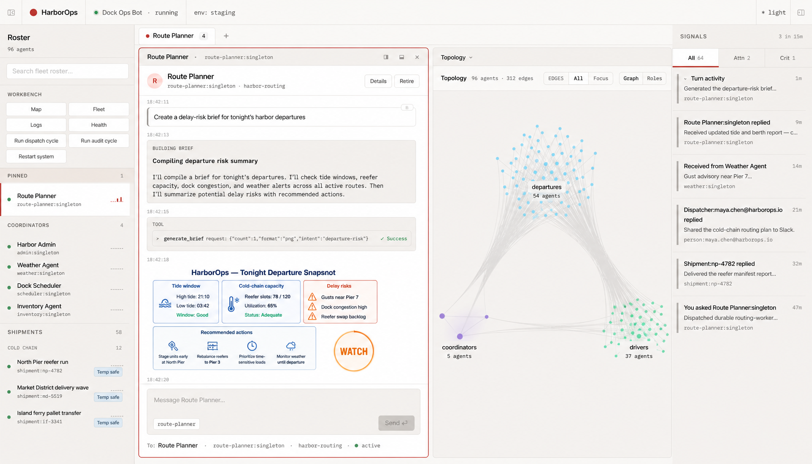

<p align="center">
  
</p>

# Meerkat Meta

**Build an application around your agents.**

Meerkat Meta composes Core agents into applications with lasting identities,
memory, routing, access policy, approvals and a console. Use it for a personal
assistant, a team of specialists or a system of agents that operates over time.
It is open source and uses Core's provider-agnostic runtime.

The instructions below build this checkout with its matching Python SDK and
gateway. For packaged installation, follow the instructions for your release.

## Start a local runtime

From this checkout, with Rust 1.94+ and Python 3.10+:

```bash
python3 -m venv .venv
.venv/bin/python -m pip install -e ./sdk/python
./scripts/repo-cargo build -p meerkat-meta --bin rpc_gateway --locked
./scripts/repo-cargo --print-env
```

The last command prints `CARGO_TARGET_DIR`. Set `META_GATEWAY` to that
location's `debug/rpc_gateway` executable, then save this as `first_runtime.py`:

```python
import asyncio
import os
from meerkat_meta import Meta

async def main():
    async with await (
        Meta.builder()
        .gateway(os.environ["META_GATEWAY"])
        .build()
    ) as runtime:
        status = await runtime.mob_handle().status()
        print("Running:", status.running)
        print("Modules:", status.loaded_modules)

asyncio.run(main())
```

```bash
.venv/bin/python first_runtime.py
```

This starts a runtime, reads its status and shuts it down. It makes no model
request and does not create a team. Next, follow the
[quickstart](docs/quickstart.mdx) to supply a mob configuration, agent roster,
provider access and console authentication. The Python and TypeScript SDKs
control a gateway; they do not bundle its executable. Rust hosts can embed Meta.

## What Meta adds

- **An application composition point.** Configure agents, their relationships,
  operational modules and persistent state together.
- **Memory that has a lifecycle.** Keep records with provenance and trust,
  recall a bounded selection, and optionally distill and consolidate in the
  background. Untrusted observations can remain quarantined.
- **Policy and approvals.** Control who can view or steer agents, and enforce
  application-defined decisions for actions that need approval.
- **Routing and operations.** Deliver work and results, supervise health, and
  expose the same application through Rust, JSON-RPC/REST/SSE and SDK clients.
- **A console.** Inspect conversations, identities, topology, memory, shared
  work, approvals and the timeline in one browser interface.

<p align="center">
  
</p>

Core owns the agent loop, sessions, stable agent identity, spawning, mob
lifecycle and communication. Meta composes those capabilities for the
application; its console and timeline reflect the underlying runtime.
For durable populations, use lasting identities and a roster. Temporary
workers can still appear and retire for individual tasks.

## Choose the other pieces independently

- [Core](https://github.com/lukacf/meerkat) can run individual agents and mobs
  without Meta. Start there when you want the runtime alone.
- **Meerkat Connect** provides optional agent-led integration setup.
  Meta can use your own integrations without it. Its native setup experience is being developed around a standalone terminal
  and the Meta console, without a user-managed Connect server.

The [Meerkat introduction](https://docs.rkat.ai/introduction) explains how the parts fit.
**Meta Forge** guides application setup, authoring and deployment packaging.
It is not required to use Meta.

## Examples and documentation

Use the [example packs](examples/README.md) to explore complete applications:
incident response, research, specialized consoles and access control. Each pack
states its prerequisites and whether it makes real model calls.

- [Introduction](docs/introduction.mdx) and [quickstart](docs/quickstart.mdx).
- [Memory](docs/concepts/memory.mdx), [access control](docs/concepts/access-control.mdx)
  and [authentication](docs/guides/authentication.mdx).
- [Unified runtime](docs/guides/unified-runtime.mdx) and
  [architecture](docs/reference/architecture.mdx).
- [Published documentation](https://docs.rkat.ai/meta/introduction).

## Development

```bash
make test-python
npm --prefix sdk/typescript run validate
```

Use `./scripts/repo-cargo` for targeted Rust commands and follow
[CONTRIBUTING.md](CONTRIBUTING.md) for repository checks. Changes to the console
must also update its embedded bundle through the existing build workflow.

## License

MIT or Apache-2.0, at your option. See [LICENSE-MIT](LICENSE-MIT) and
[LICENSE-APACHE](LICENSE-APACHE).
